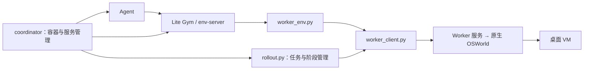

# OSWorld-V2 接入说明

这里将 OSWorld-V2 接入 CUA-Lite，支持 **0624、0808、v2.1**。三个版本共用适配代码，分别使用对应的任务、素材和 Worker 镜像。

- **运行任务**：先照[完整例子：v2.1 的 054](/lite/gym/envs/osworld_2/WORKER.md)准备文件、提交、看结果并回收，再修改 [run.yaml](/lite/platforms/sandbox/osworld_2/configs/run.yaml)切换任务
- **部署 Sandbox**：[镜像、数据和提交方法](/lite/platforms/sandbox/osworld_2/README.md)
- **接入其他 benchmark**：按[六步开发示例](/lite/gym/envs/ADDING_BENCHMARKS.md#example-integration)实现环境、注册、验证与部署；同页包含接入 SPEC

<a id="deployment-and-ownership"></a>

## 各部分做什么

| 部分 | 职责 |
|---|---|
| Agent | 使用通用镜像和 `lite.agents.episode`，调用模型、选择动作并记录轨迹 |
| env-server | 在 coordinator 内运行，向 Agent 提供统一的 Lite 环境接口 |
| Worker | 运行原生 OSWorld，管理桌面 VM、用户模拟器和评分 |
| 桌面 VM | 真正执行鼠标、键盘操作的桌面 |
| `rollout.py` | 只协调任务初始化、阶段切换、评分、结果记录和最终清理 |
| coordinator | 使用 benchmark 镜像启动 env-server，并为每个阶段启动独立 Agent 容器 |



Agent 的动作经过 Lite 环境接口；benchmark runner 另用 Worker 连接管理整个任务。env-server 本身不创建桌面 VM。Worker 与 coordinator 使用同一 benchmark 镜像、分别运行在两个容器中；Agent 使用独立通用镜像。

本工作区的这些进程均在 Sandbox 内运行；工作站负责提交、监控和同步结果。Agent 容器限制为 8 GiB，桌面 VM 为 4G，两者都计入外层 Sandbox 预算。Agent 不挂载 Docker socket、KVM、任务数据或 Worker 管理凭据；coordinator 持有 Docker socket，是可信管理进程，不能视为安全隔离边界。

<a id="release-support"></a>

## 版本怎么选

| 版本 | `--release` | Gym / env-server ID | 任务集 |
|---|---|---|---|
| 0624 | `osworld-v2-2026.06.24` | `osworld_2` | `full`：108 项 |
| 0808 | `osworld-v2-2026.08.08` | `osworld_2.v2026_08_08` | `full`：108 项 |
| v2.1（默认） | `osworld-v2.1` | `osworld_2.v2_1` | `full`：108 项；`offline`：82 项 |

单个任务使用 `<env_id>@<任务 ID>`，例如 `osworld_2.v2_1@054`。
所有版本都支持指定任务 ID；0624、0808 没有官方 offline 子集。

Worker 镜像、任务、素材和网站版本必须与所选 release 匹配。只改 `--release` 不会更新已部署的 Worker。

目前 0624 的 7 个交互任务和多阶段任务 069 仍在排除清单中；0808、v2.1 的清单已根据此前部署的验证清空。此次独立 Agent 镜像部署已通过三个版本的 054 协议检查，最终镜像通过 v2.1 的两轮真实模型短测；交互与多阶段尚未在新部署重跑。协议通过情况与模型任务得分分别记录，详见[验证说明](/lite/gym/envs/osworld_2/WORKER.md#verification-and-extension)。

<a id="code-map"></a>

## 代码从哪里看

推荐顺序：**`main.py → catalog.py → worker_env.py`**，先理解注册、版本选择和环境适配。

```text
osworld_2/
├── main.py               # 注册任务、metadata 和配置
├── catalog.py            # 读取版本信息、选择任务集
├── worker_env.py         # Lite 的 reset / step / close，动作与反馈
├── worker_client.py      # 调用 Worker HTTP 接口
├── rollout.py            # 任务与阶段生命周期，不调用模型
├── smoke.py              # 不调用模型的环境连通性检查
├── artifacts.py          # 运行记录、事件和汇总
├── releases/             # 各版本的任务清单与配置
└── worker/               # Worker 原生运行代码与镜像构建
```

- **`releases/`**：`index.json` 绑定版本与 env ID；各版本保存官方 `release.json`、任务 ID、`task_hashes.json`、排除清单和配置。Worker 在任务初始化前校验源码哈希。官方子集放在 `task_sets/`。
- **`worker/`**：`prepare.py --wheel …` 将上游源码和已构建的 CUA-Lite wheel 放入构建目录。镜像将原生 OSWorld 与 coordinator/env-server 依赖分别安装；后者使用 `/opt/cua-benchmark-venv`。`worker_service.py` 管理请求，`worker_runtime.py` 调用原生任务与评分器。
- **Agent 与协调器**：[episode.py](/lite/agents/episode.py) 只接收 Lite 环境、模型配置和输出位置；[coordinator.py](/lite/platforms/sandbox/osworld_2/coordinator.py) 负责 OSWorld 的容器启动与服务连接。
- **部署与结果**：Sandbox 配置归属 [platforms/sandbox/osworld_2](/lite/platforms/sandbox/osworld_2)；截图、轨迹和验证报告写入实验输出目录。

<a id="using-this-integration-as-a-reference"></a>

## 接入其他 benchmark 时参考什么

先实现 [LiteBaseEnv](/lite/gym/base.py) 并[注册任务](/lite/gym/registry.py)，通过原生 env-server 接入通用 [Agent 入口](/lite/agents/episode.py)。独立 Worker、多阶段协调和专用输出管理按实际需要添加；模型 prompt、截图历史和 JSONL 导出由 `lite/agents` 负责。

新 benchmark 满足既有 Lite 契约时，只发布自己的环境镜像与部署配置，即可复用已发布 Agent 镜像。修改 Agent、模型适配器、其 Python 依赖或 Lite 线上协议时再更新相关镜像，并用集成检查确认兼容性；不要求两边来自同一次 commit。

参考测试位于 [tests/gym/envs/osworld_2](/tests/gym/envs/osworld_2)：根目录检查注册，`worker/` 下覆盖环境动作、HTTP、阶段、输出和构建。多人协作边界与验收要求见[接入 SPEC](/lite/gym/envs/ADDING_BENCHMARKS.md)。

上游资料：[OSWorld-V2 源码](https://github.com/xlang-ai/OSWorld-V2) · [OSWorld 2.0 论文](https://arxiv.org/abs/2606.29537) · [OSWorld 论文](https://arxiv.org/abs/2404.07972)。研究中请同时引用上游工作与 [CUA-Lite](/README.md#citation)。
